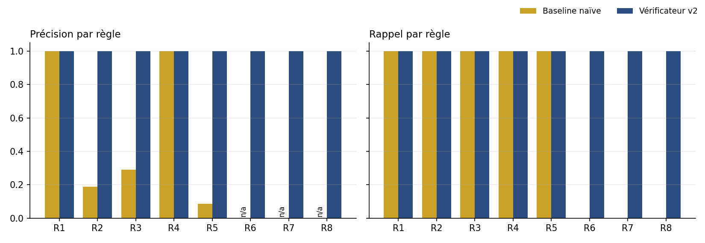
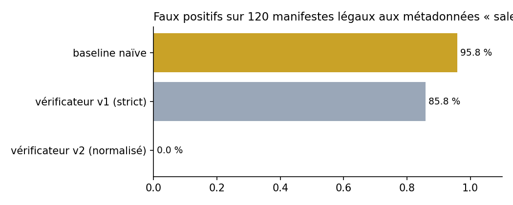

# Rapport — K2 : Traçabilité et licences des générations

Module GenAI 2026-2027 · Sujet K2 (difficulté 2/5)

## 1. Problème et verrou technique

Un contenu produit par IA générative combine plusieurs éléments soumis à des conditions d'usage : les **poids du modèle** (licence Apache, OpenRAIL, « recherche uniquement »…), les **sources** injectées (articles, images de référence, musiques sous Creative Commons) et les **transformations** successives (génération, upscaling, narration, mixage). Sans trace structurée, il devient impossible de répondre à des questions simples : *ce visuel peut-il être utilisé dans une campagne commerciale ? qui faut-il créditer ? ce fichier a-t-il été retouché après coup ?*

Le verrou n'est pas de rédiger un texte juridique, mais de rendre la traçabilité **exploitable et vérifiable par une machine** :
1. un format de manifeste complet ;
2. des règles de compatibilité automatisables ;
3. une mesure objective de leur fiabilité (détections et faux positifs) sur des cas dont la vérité est connue.

## 2. Solution

### 2.1 Manifeste JSON

Chaque génération produit un manifeste contenant : identifiant, type de média, date, **usage visé** (commercial ou non), **licence de sortie**, **empreinte SHA-256 du contenu**, modèles (nom, version, licence), prompt (texte + empreinte), sources (identifiant, titre, auteur, licence, URL, empreinte), transformations (étape, outil, caractère dérivé), attributions et **parents** (empreintes des manifestes d'origine).

Le champ `parents` forme une **chaîne de provenance** : un audio narré à partir d'un texte référence le manifeste de ce texte et hérite de ses sources, donc de ses contraintes.

### 2.2 Trois pipelines média

| Pipeline | Étapes | Modèles tracés |
|---|---|---|
| Texte | recherche de sources → génération | TextGen-7B (Apache-2.0), TinyLM-1B (MIT), ResearchGen-13B (recherche uniquement) |
| Image | génération d'après images de référence → upscaling | ImageGen-XL (OpenRAIL-M), Upscaler-4x (BSD-3) |
| Audio | TTS d'un texte existant → mixage avec musique | VoiceTTS (MIT), ffmpeg |

Les générations sont **simulées de façon déterministe** : l'objet du sujet est la traçabilité, pas la qualité des contenus. Ce choix garantit un budget de 0 € et une reproductibilité exacte (c'est aussi le plan B prévu par la fiche).

### 2.3 Base de licences

Onze licences SPDX décrites par quatre attributs (usage commercial, dérivées autorisées, share-alike, attribution), plus une table d'**alias** (« CC BY 4.0 », « MIT License »…) normalisés vers l'identifiant SPDX.

### 2.4 Vérificateur : 8 règles

| Règle | Vérification |
|---|---|
| R1 | Champs obligatoires présents et non vides |
| R2 | Licences reconnues après normalisation |
| R3 | Pas de source/modèle NC pour un usage commercial, ni de licence de sortie plus permissive qu'une source NC |
| R4 | Pas de source ND dans une chaîne qui transforme |
| R5 | Une source SA impose la même licence en sortie |
| R6 | Chaque auteur dont la licence exige une attribution est crédité |
| R7 | Empreintes du contenu et du prompt valides (détection de retouche) |
| R8 | Chaque parent existe dans le registre des manifestes |

### 2.5 Baseline

Une **liste noire par mots-clés**, proche de ce qu'on ferait sans manifeste structuré : signaler toute licence contenant « NC », « ND » ou « SA », rejeter toute licence qui n'est pas écrite exactement comme dans la liste, sans vérifier ni attributions, ni empreintes, ni parents.

## 3. Protocole d'évaluation

**Corpus principal (graine 42, 290 générations).**
- 150 manifestes **conformes** : 60 textes, 45 images, 45 audios. Ils incluent des cas pièges légaux : source NC pour un usage non commercial, source SA avec la bonne licence de sortie, alias de licences (15 %).
- 120 **violations simples** injectées (15 par règle) et 20 **doubles violations** (paires parmi R3, R4, R6, R7), soit 140 manifestes fautifs dont la vérité terrain est connue.

**Corpus de robustesse (graine 7, 120 générations).** Uniquement des manifestes **conformes aux règles du démonstrateur**, avec des métadonnées « sales » comme en saisie réelle : 60 % d'alias de licences, noms d'auteurs avec casse et séparateurs variables (« AUTEUR-0012 », « auteur_0012 »). Toute alerte est un faux positif.

**Métriques.** Précision, rappel et F1 par règle ; taux de détection des manifestes fautifs ; taux de fausses alertes sur les conformes ; diagnostic exact (bonnes règles identifiées) ; couverture des métadonnées ; reproductibilité de l'export (empreinte SHA-256 du corpus exporté).

## 4. Résultats

### 4.1 Corpus principal

| Indicateur | Baseline naïve | Vérificateur |
|---|---|---|
| Manifestes fautifs détectés | 55,0 % | 100 % |
| Fausses alertes sur manifestes conformes | 74,7 % | 0 % |
| Diagnostic exact | 23,1 % | 100 % |
| Précision (micro) | 24,7 % | 100 % |
| Rappel (micro) | 59,4 % | 100 % |



La baseline détecte bien les violations visibles dans le nom des licences (rappel de 100 % sur R3, R4, R5), mais avec une précision très faible (8,6 % sur R5, 18,8 % sur R2). Elle signale toute licence SA ou NC même utilisée légalement et rejette les alias. Elle ne voit aucune violation qui demande de **croiser des champs** : attribution (R6), retouche (R7), parent (R8).

**Interprétation honnête.** Le score de 100 % du vérificateur est **attendu** : les violations ont été injectées selon le même modèle de licences que celui des règles. Il vérifie les cas construits pour cette campagne, sans prouver une correction générale. Le test suivant répond à cette limite.

### 4.2 Robustesse : métadonnées légales mais « sales »

| Vérificateur | Faux positifs | Règles en cause |
|---|---|---|
| Baseline naïve | 115 / 120 (95,8 %) | R2 ×96, R5 ×64, R3 ×48 |
| Vérificateur v1 (comparaison stricte des auteurs) | 103 / 120 (85,8 %) | R6 ×103 |
| Vérificateur v2 (noms d'auteurs normalisés) | 0 / 120 (0 %) | — |



**Analyse d'erreur.** La v1 comparait les noms d'auteurs caractère par caractère : un simple « AUTEUR-0012 » au lieu de « Auteur-0012 » déclenchait une fausse alerte d'attribution. La v2 normalise les noms (casse, espaces, tirets, underscores) avant comparaison. Les faux positifs tombent à zéro **sans perte de détection** : v1 et v2 obtiennent le même score sur les 140 violations du corpus principal. C'est le résultat le plus instructif du projet : la difficulté pratique de la traçabilité tient moins aux règles de licence qu'à la **qualité des métadonnées**.

### 4.3 Couverture et reproductibilité

- Couverture des champs obligatoires et recommandés : 100 % sur les manifestes conformes, 99,8 % sur l'ensemble du corpus (minimum 94,4 %, causé par les suppressions de champs injectées pour R1).
- Deux exécutions avec la graine 42 produisent un export **identique au bit près** (empreinte `ba08ace2…1419f8d`) ; une autre graine produit un export différent.
- 20 tests unitaires valident les règles, la robustesse et la reproductibilité.

## 5. Interface d'audit

`outputs/audit.html` est une page autonome, utilisable hors ligne. Elle liste les 290 générations avec leur statut, permet de filtrer par statut, règle et média et de rechercher un identifiant, une licence ou un auteur. Un clic sur une ligne affiche les constats en clair et le manifeste complet.

## 6. Limites

- **Licences simplifiées.** Quatre attributs par licence. Les restrictions d'usage des licences de type OpenRAIL (usages interdits) et les compatibilités fines entre licences SA différentes ne sont pas modélisées.
- **Corpus synthétique.** La vérité terrain est garantie, mais la diversité des erreurs réelles est sous-estimée. Le test de robustesse n'en couvre qu'une partie (alias, saisie des noms).
- **Confiance dans le manifeste.** Une empreinte prouve qu'un contenu n'a pas changé depuis l'écriture du manifeste, pas que le manifeste dit vrai. Une signature cryptographique (C2PA) rattacherait le manifeste à son émetteur.
- **Normalisation des auteurs.** Elle peut confondre deux auteurs qui ne diffèrent que par la ponctuation. Un identifiant stable (ORCID, URI) serait plus sûr.

## 7. Extensions possibles

Manifeste signé au format C2PA ; SBOM de modèles ; politiques organisationnelles (par exemple « aucun modèle research-only en production ») ; corpus de robustesse construit à partir de métadonnées réelles (Wikimedia Commons, Hugging Face).

## 8. Ressources

**CoursIA** : [Production Integration](https://github.com/jsboige/CoursIA/blob/main/MyIA.AI.Notebooks/GenAI/Image/04-Applications/04-3-Production-Integration.ipynb) · [Production Patterns](https://github.com/jsboige/CoursIA/blob/main/MyIA.AI.Notebooks/GenAI/Texte/09_Production_Patterns.ipynb)

**Références** : [SPDX](https://spdx.dev/) · [Model Cards for Model Reporting](https://arxiv.org/abs/1810.03993) · [C2PA](https://c2pa.org/)

## Annexe — Reproduire

```bash
pip install matplotlib pandas
python run_all.py
python -m unittest discover tests
```

---

## 9. Corrections issues de l'audit du 16 octobre 2026

Deux défauts ont été reproduits : l'absence de prompt.sha256 passait sans alerte et une valeur entière ou une chaîne dans sources pouvait provoquer une exception. La nouvelle fonction validate_manifest contrôle les types, les champs obligatoires et les objets imbriqués avant les règles métier. Les sources et modèles exigent maintenant leurs métadonnées attendues.

Si la structure est inexploitable, check retourne des constats R1 et suspend les règles métier. Une empreinte absente est une erreur de complétude, tandis qu'une empreinte présente mais incohérente avec le contenu relève de R7. Les sources, modèles, transformations, attributions et parents mal typés produisent des messages explicites.

Validation : les 8 tests initiaux et 12 tests de régression réussissent. Les métriques de la campagne principale sont identiques à la version initiale. Les 12 nouveaux tests ne sont pas inclus dans les 290 artefacts de cette campagne. Les figures et resultats.json ont été régénérés après correction.

Les pipelines image et audio écrivent des octets synthétiques SIMPNG / SIMWAV, non des médias lisibles. La validation n'ajoute ni génération réelle ni signature C2PA.

Assistance déclarée : version initiale préparée par Claude, audit et correctifs préparés avec ChatGPT. Les étudiantes doivent relire et comprendre ce travail avant soumission.
